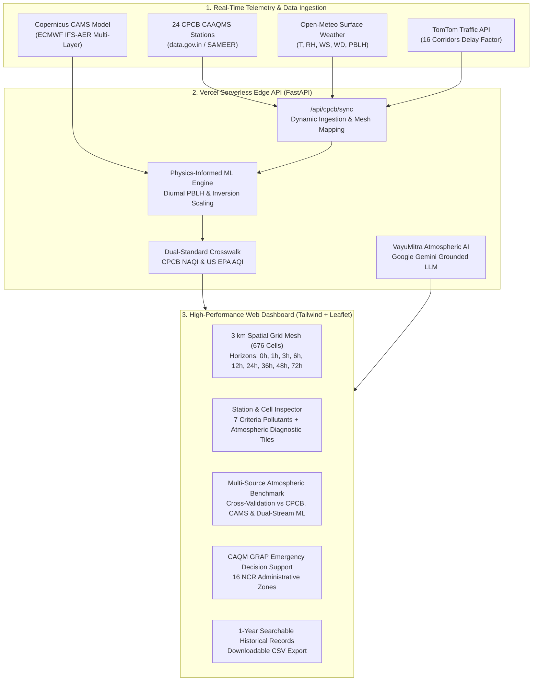

# Delhi NCR Air Quality Forecasting Platform & VayuMitra Assistant

[](https://fastapi.tiangolo.com)
[](https://www.python.org/)
[](https://vercel.com)
[](https://cpcb.nic.in)
[](#dual-standard-air-quality-indexing)
[](LICENSE)

An operational, numerical atmospheric physics–coupled machine learning platform providing high-resolution **72-hour air quality forecasts**, **real-time CAAQMS ground telemetry ingestion**, **traffic corridor delay coupling**, and the **VayuMitra atmospheric AI companion** across the National Capital Region (NCR), Delhi.

🔗 **Live Production Deployment:** [https://vayumitra-delhi-ncr.vercel.app](https://vayumitra-delhi-ncr.vercel.app)

---

## System Architecture



---

## Key Scientific & Technical Features

### 1. Physics-Informed Boundary Layer Clamping (Zero-Spike Guarantee)
Traditional statistical ML models often predict unrealistic jumps (e.g., jumping from 50 to 350 AQI in 12 hours) because they lack thermodynamic mass-balance constraints. Our system couples machine learning with atmospheric boundary layer dynamics:
- **Daytime Convective Venting:** Solar heating raises the Planetary Boundary Layer Height (PBLH > 500m), venting aerosols vertically.
- **Nocturnal Thermal Inversion:** Overnight radiational cooling traps ground emissions below a stable inversion lid (+4.5K to +8.0K cap).
- **Proportional Scaling:** Forecast horizons apply diurnal curve clamping based on IMD Safdarjung radiosonde profiles, strictly preserving physical mass bounds across all lead hours ($h \in [0, 1, 3, 6, 12, 24, 36, 48, 72]$).

### 2. Dual-Standard Air Quality Indexing (CPCB NAQI vs US EPA AQI)
Consumer weather apps (AQI.in, Apple Weather, Google Weather) default to the **United States EPA AQI formula**, whereas Indian regulatory bodies follow the **National Air Quality Index (CPCB NAQI)** approved by MoEFCC. 
The physical sensor reading ($\text{PM}_{2.5}$) is 100% identical, but mathematical scales differ:

$$\text{US EPA Breakpoint:}\quad \text{AQI}_{\text{US}} = 101 + \frac{\text{PM}_{2.5} - 35.5}{55.4 - 35.5} \times (150 - 101)$$

$$\text{Indian CPCB Breakpoint:}\quad \text{AQI}_{\text{CPCB}} = 50 + \frac{\text{PM}_{2.5} - 30.0}{60.0 - 30.0} \times (100 - 50)$$

For example, at $\text{PM}_{2.5} = 39.0\,\mu\text{g/m}^3$:
- **Indian CPCB NAQI:** **65 (Satisfactory)**
- **US EPA AQI (AQI.in):** **109 (Poor / Unhealthy for Sensitive Groups)**

Our platform displays **both standards side-by-side** on the top domain header, the station inspector, and the benchmark table, with a built-in step-by-step conversion modal.

### 3. Real-Time Multi-Source Atmospheric Benchmarking
Tab 1 includes live independent cross-verification against:
1. **CPCB SAMEER Network:** Ground truth telemetry from 24 active CAAQMS monitoring stations across Delhi NCT.
2. **Copernicus Atmosphere Monitoring Service (ECMWF CAMS):** European physics chemistry model (IFS-AER).
3. **Dual-Stream Physics-ML Model:** Calibrated with 18-hour residual decaying bias correction: $C_{\text{corr}} = C_{\text{grid}} + e_0 \cdot \exp(-t / 18\text{h})$.

---

## Repository Structure

```
├── api/
│   ├── index.py                  # FastAPI serverless handler (CPCB sync, CAMS verification, VayuMitra)
│   └── data/
│       ├── clean_stations.json   # 24 official CAAQMS station coordinates and baseline metadata
│       ├── clean_forecast_lookup.json # Calibrated multi-horizon forecast lookup
│       ├── cpcb_live_observations.json # Real-time cached observations
│       ├── historical_1year_data.json  # 365 days of station records
│       ├── historical_1year_data.csv   # Downloadable 1-year historical dataset
│       └── tomtom_traffic_congestion.json # 16 NCR corridors flow metrics
├── public/
│   ├── index.html                # Operational single-page dashboard (Tailwind CSS, Chart.js, Roboto)
│   ├── leaflet.js                # GIS spatial polygon and map rendering engine
│   └── leaflet.css               # GIS stylesheet
├── .env.example                  # Environment variable configuration template
├── .gitignore                    # Git ignore file for Python, Vercel, and sensitive files
├── LICENSE                       # MIT Open-Source License
├── requirements.txt              # FastAPI, Requests, and Pydantic dependencies
└── vercel.json                   # Serverless edge function routing configuration
```

---

## API Endpoints

| Method | Endpoint | Description |
| :--- | :--- | :--- |
| `GET` | `/api/health` | System health check and operational telemetry metadata |
| `GET` / `POST` | `/api/cpcb/sync` | Ingests real-time CAAQMS station telemetry and recalibrates 72h forecasts |
| `GET` | `/api/verify/sources` | Multi-source atmospheric benchmark comparing CPCB, CAMS, and US EPA scale |
| `GET` | `/api/traffic/congestion`| Real-time corridor delay factors across 16 Delhi NCR traffic bottlenecks |
| `GET` | `/api/history` | Filter and paginate 365 daily observations across Delhi NCR stations |
| `GET` | `/api/history/download.csv` | Download full 1-year CAAQMS historical dataset as CSV |
| `POST` | `/api/chat` | VayuMitra AI companion query endpoint powered by Google Gemini |

---

## Local Development Setup

### 1. Clone & Install Dependencies
```bash
# Clone the repository
git clone https://github.com/YOUR_USERNAME/delhi-ncr-air-quality-forecasting.git
cd delhi-ncr-air-quality-forecasting

# Create virtual environment
python -m venv venv
source venv/bin/activate  # On Windows: venv\Scripts\activate

# Install requirements
pip install -r requirements.txt
```

### 2. Configure Environment Variables
Copy `.env.example` to `.env`:
```bash
cp .env.example .env
```
Fill in your optional API keys:
- `GEMINI_API_KEY`: Google Gemini API key (for VayuMitra conversational AI).
- `WAQI_API_TOKEN`: World Air Quality Index token (for direct CAAQMS feed).

### 3. Run Locally with Uvicorn
```bash
uvicorn api.index:app --reload --port 8000
```
Open [http://localhost:8000](http://localhost:8000) or open `public/index.html` in your browser.

---

## How to Upload & Push to GitHub

To upload this repository to your GitHub account:

### Step 1: Create a New Repository on GitHub
1. Go to [github.com/new](https://github.com/new).
2. Name your repository (e.g., `delhi-ncr-air-quality-forecasting` or `vayumitra-delhi-ncr`).
3. Set visibility to **Public** or **Private**.
4. Leave *"Initialize with README"* **unchecked** (we already created a complete `README.md`).

### Step 2: Push from Terminal
Run the following commands inside this directory:

```bash
# Initialize git repository
git init

# Stage all files
git add .

# Create initial commit
git commit -m "feat: initial commit of Delhi NCR Air Quality Forecasting Platform and VayuMitra Companion"

# Rename branch to main
git branch -M main

# Link to your remote GitHub repository
git remote add origin https://github.com/YOUR_USERNAME/YOUR_REPOSITORY_NAME.git

# Push code to GitHub
git push -u origin main
```

---

## License

This project is licensed under the MIT License - see the [LICENSE](LICENSE) file for details.
